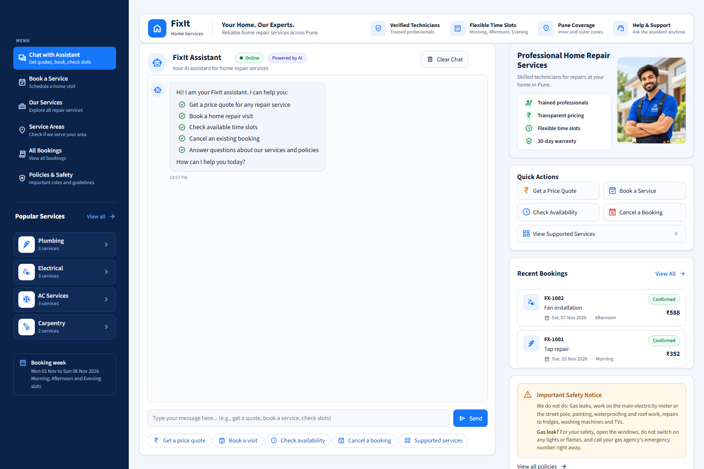

# FixIt Booking Agent

An AI booking assistant for a home repair service, built with the OpenAI Agents SDK, FastAPI and
Streamlit for the Applied Agentic AI Module 6 assignment.

## Project Overview

FixIt Home Services is a fictional company that sends plumbers, electricians, AC technicians and
carpenters to homes in Pune. This project replaces its phone bookings with a chat assistant.

A customer writes one request in plain English, for example:

> My kitchen tap is leaking. Please send a plumber on Tuesday morning. Meera Joshi, 9876543210, pin 411038.

The assistant replies with a price quote, a confirmed booking, a cancellation, a request for missing
details, or a polite refusal. The language model (`gpt-4.1-mini`) understands the request and decides
which tool to call. Every price, availability check, booking ID and cancellation fee is produced by
Python code that reads the company data supplied with the assignment.

The project runs locally. It is not deployed online.

## Application Preview



## Problem Statement

A booking assistant for a real business must follow the company's rules exactly. It has to:

- serve only the listed PIN codes
- charge the correct price every time
- never book a slot that is already taken
- ask for missing details instead of guessing them
- refuse work the company does not do

Language models are good at understanding requests, but they can invent numbers and details. This
project separates the two jobs. The model interprets the request and chooses a tool. Plain Python
functions apply the business rules, calculate prices and store bookings. Python code then checks the
model's final answer, so prices, booking IDs and fees always come from the tools.

## Key Features

- **Price quotes** with a full breakdown: service price, visit charge, weekend extra, GST and total.
  A quote never creates a booking.
- **Bookings** with sequential IDs (FX-1001, FX-1002, ...). Repeating the same booking (same phone
  number, date and slot) returns the original booking ID instead of creating a duplicate.
- **Availability**: Morning, Afternoon and Evening slots. When a slot or day is not available, the
  free slots or the next free day are offered.
- **Cancellations**: free before the visit day, Rs 99 on the day of the visit. The slot becomes free again.
- **Safety handling**: unsupported work is refused, and a gas leak always receives the exact safety
  message from `data/policies.md`.
- **Structured responses**: every answer follows one Pydantic model with six statuses.
- **Streamlit dashboard**: chat, booking form, service catalogue, service areas, all bookings and
  policies, usable on desktop, tablet and phone.

The agent uses six tools, all defined in `tools.py`:

| Tool | Purpose |
|------|---------|
| `check_area(pin_code)` | Confirms the PIN code is served and returns the area, zone and visit charge |
| `find_services(category)` | Lists the services, IDs and prices for one type of work |
| `get_price_quote(service_id, pin_code, date)` | Calculates the full price for a service, area and date |
| `check_slots(category, date)` | Lists the free slots for a date, or the next free day if it is full |
| `book_visit(name, phone, pin_code, service_id, date, slot)` | Validates every detail, then saves the booking |
| `cancel_booking(booking_id)` | Cancels a booking and returns the cancellation fee |

## Technology Stack

| Component | Technology |
|-----------|------------|
| Language | Python 3.12 |
| AI agent | OpenAI Agents SDK with `gpt-4.1-mini` (maximum 10 agent turns) |
| Response model | Pydantic |
| Back end | FastAPI, served by Uvicorn |
| Front end | Streamlit |
| Configuration | python-dotenv (reads the API key from `.env`) |
| Images | Pillow (prepares the technician photo) |
| Storage | JSON files (`data/` for company data, `bookings.json` for bookings) |

## System Architecture

```
Streamlit dashboard (app.py)
        |   HTTP: POST /request, GET /bookings, GET /health
        v
FastAPI back end (api.py)
        |   run_agent(message)
        v
Agent (agent.py)  <---->  OpenAI API (gpt-4.1-mini)
        |   tool calls
        v
Python tools (tools.py)
        |
        +--> data/services.json, data/service_areas.json, data/slots.json   (read only)
        +--> bookings.json                                                  (bookings saved here)
```

1. The customer types a request in the Streamlit dashboard, which sends it to `POST /request`.
2. FastAPI passes the message to `run_agent()` in `agent.py`.
3. The agent sends the message, the company policies and the six tools to the model. The model
   decides which tools to call.
4. The tools read the data files, apply the rules and, for bookings and cancellations, update
   `bookings.json`.
5. `agent.py` builds the final answer from the tool results and returns it to FastAPI and the dashboard.
6. The dashboard shows the answer as a card and reloads the booking list from `GET /bookings`.

## Project Structure

```
fixit-agent/
  agent.py                 Agent instructions, tool wrappers, response model and answer checks
  tools.py                 The six business tools; all prices and rules are applied here
  api.py                   FastAPI back end with three endpoints
  app.py                   Streamlit dashboard
  assets/
    styles.css             Dashboard styles
    technician.png         Technician photo shown in the dashboard
  data/
    services.json          11 services with prices (supplied with the assignment)
    service_areas.json     Served PIN codes, zones and visit charges (supplied)
    slots.json             Time slots for the booking week (supplied)
    policies.md            Company rules, also given to the agent (supplied)
  screenshots/
    fixit-dashboard.png    Screenshot used in this README
  tests/
    test_fixit.py          Tests for the tools, response model and API
    test_app.py            Tests for the Streamlit dashboard
    test_audit.py          Independent checks of every service, area, day and slot
  .streamlit/
    config.toml            Streamlit theme
  .env.example             Template for your local .env file
  .gitignore               Files kept out of Git
  requirements.txt         Python packages
  CLAUDE.md                Project rules written for Claude Code (an assignment deliverable)
  test_results.md          Results of the official practice requests and live checks
```

`bookings.json` is created automatically when the first booking is made. The four Python modules stay
in the project root because the assignment brief specifies this layout and the commands
`python agent.py`, `uvicorn api:app` and `streamlit run app.py`.

**Where to find the key code:**

| Topic | Location |
|-------|----------|
| Price calculation | `calculate_quote()` in `tools.py` |
| Booking validation, duplicates and saving | `create_booking()` in `tools.py` |
| Availability and next free day | `list_slots()` and `find_other_free_day()` in `tools.py` |
| Cancellation fee | `cancel_existing_booking()` in `tools.py` |
| Agent instructions | `build_instructions()` in `agent.py` |
| Response model | `FixItResponse` in `agent.py` |
| Request handling and answer checks | `run_agent()` and `apply_tool_results()` in `agent.py` |
| API endpoints | `api.py` |

## Booking Workflow

1. **Request received.** `POST /request` accepts the message. A blank message is rejected with HTTP 400.
2. **Pre-checks in `agent.py`.**
   - The message is passed to the model as customer text only.
   - Attempts to override the rules, such as "ignore your rules", are flagged.
   - Any six-digit PIN code in the message is checked with `check_area` first.
3. **Service identification.** The model calls `find_services` and matches the customer's problem to a
   service. For example, a leaking pipe is Pipe leak repair and a leaking tap is Tap repair. If the
   description could fit several services, it asks which one is needed.
4. **Missing information.** A booking needs six details: name, 10-digit mobile number, PIN code,
   problem, date and slot. If any are missing, the agent asks for them and nothing is booked.
5. **Quote or booking.**
   - For a price question, the model calls `get_price_quote` and the answer is a quote.
   - For a booking, the model calls `book_visit`. It checks the details, the PIN code, the booking
     week, the Sunday rule for electricians, duplicates and slot availability, then calculates the
     price and saves the booking.
6. **Answer checks.** `apply_tool_results()` copies the prices, booking ID and fee from the tool results
   into the final answer. A booking that the tool did not confirm is never reported as booked. A gas
   leak always receives the exact safety message.
7. **Response.** The answer is returned with one of six statuses:

| Status | Meaning |
|--------|---------|
| `booked` | The visit was booked, or was already booked for the same phone, date and slot |
| `quote_only` | A price was given and no booking was made |
| `cancelled` | The booking was cancelled; the fee is included |
| `need_more_info` | Details are missing or invalid, or the requested slot or day is not available |
| `cannot_help` | The area is not served, the work is not offered, or the booking ID is unknown or already cancelled |
| `stopped` | The agent reached the 10-turn limit or the OpenAI API could not be reached |

## Pricing Calculation

`calculate_quote()` in `tools.py` uses this formula:

```
subtotal = service price (services.json)
         + visit charge (service_areas.json: Rs 99 inner zone, Rs 149 outer zone)
         + Rs 100 if the visit is on a Saturday or Sunday
GST      = 18% of the subtotal, rounded to the nearest rupee (0.5 rounds up)
total    = subtotal + GST
```

| Example (official practice requests) | Calculation | Total |
|--------------------------------------|-------------|-------|
| Pipe leak repair, 411004 (inner), Wednesday | 349 + 99 + 0 = 448; GST 80.64 rounded to 81 | Rs 529 |
| Tap repair, 411038 (inner), Tuesday | 199 + 99 + 0 = 298; GST 53.64 rounded to 54 | Rs 352 |
| Fan installation, 411021 (outer), Saturday | 249 + 149 + 100 = 498; GST 89.64 rounded to 90 | Rs 588 |

Service prices range from Rs 149 (Light fitting) to Rs 2,499 (AC gas refill). There are no discounts
or free visits.

## Business Rules and Safety

These rules come from `data/policies.md` and the assignment brief.

| Rule | Detail |
|------|--------|
| Fixed date | Today is Monday 2 November 2026. Bookings are open from 2 to 8 November 2026. |
| Time slots | Morning (9 AM to 12 PM), Afternoon (12 PM to 3 PM), Evening (3 PM to 6 PM) |
| Capacity | One technician per type of work per slot. A slot is taken if `slots.json` marks it booked or an active booking uses it. |
| Electricians | Do not work on Sundays |
| Service areas | 5 inner-zone PIN codes (Rs 99 visit charge) and 4 outer-zone PIN codes (Rs 149) |
| Phone number | Must be 10 digits; spaces and hyphens are removed first |
| Cancellation | Free before the visit day, Rs 99 on the day of the visit |
| Not offered | Gas leaks, main electricity meter or street-pole work, painting, waterproofing, roof work, and fridge, washing machine or TV repairs |

For a gas leak, the customer receives the exact safety message from `data/policies.md`:

> For your safety, open the windows, do not switch on any lights or flames, and call your gas agency's
> emergency number right away.

For meter or street-pole work, the customer is told to contact their electricity provider.

## Installation and Setup

**Requirements:**
- Windows with PowerShell
- Python 3.12
- An OpenAI API key with access to `gpt-4.1-mini`
- An internet connection

Run these commands from the project root:

```powershell
# Check the Python version
py -3.12 --version

# Create and activate a virtual environment
py -3.12 -m venv .venv
.\.venv\Scripts\Activate.ps1

# Install the dependencies
python -m pip install -r requirements.txt

# Create your local .env file from the template, then add your own API key
Copy-Item .env.example .env
notepad .env
```

`.env` must contain one line with your own key:

```
OPENAI_API_KEY=your_openai_api_key_here
```

If PowerShell blocks `Activate.ps1`, run `Set-ExecutionPolicy -Scope CurrentUser RemoteSigned` once,
then activate again.

## Running the Application

Open two PowerShell windows in the project root and activate the virtual environment in both
(`.\.venv\Scripts\Activate.ps1`).

**Window 1: FastAPI back end**

```powershell
uvicorn api:app --reload
```

The API runs at http://127.0.0.1:8000, with interactive documentation at http://127.0.0.1:8000/docs.
Token usage for each request is printed in this window.

**Window 2: Streamlit front end**

```powershell
streamlit run app.py
```

The dashboard opens at http://localhost:8501. Start the back end first; otherwise the dashboard shows
"Offline". To use a back end at another address, set `$env:FIXIT_API_URL` before starting Streamlit.

**Optional: terminal demo**

```powershell
python agent.py
```

This sends the four official practice requests and a gas leak request, and prints each answer. It
writes to `bookings.json`, so delete that file first to start again from FX-1001.

## API Endpoints

| Method | Path | Request body | Response |
|--------|------|--------------|----------|
| POST | `/request` | `{"message": "..."}` | The agent's answer (fields below). A blank message returns HTTP 400. |
| GET | `/bookings` | none | All bookings in `bookings.json`. HTTP 500 with a message if the file cannot be read. |
| GET | `/health` | none | `{"status": "ok"}` |

Fields returned by `POST /request`:

| Field | Content |
|-------|---------|
| `status` | One of the six statuses above |
| `message` | The agent's reply to the customer |
| `booking_id` | For example `FX-1001`, otherwise `""` |
| `service_name`, `date`, `slot` | What was booked, priced or cancelled, otherwise `""` |
| `job_price`, `visit_charge`, `weekend_extra`, `gst`, `total_price` | Whole rupees from the tools, otherwise `0` |
| `cancellation_fee` | 0 or 99 after a cancellation, otherwise `0` |

Example request from PowerShell:

```powershell
Invoke-RestMethod -Method Post -Uri http://127.0.0.1:8000/request `
  -ContentType "application/json" `
  -Body '{"message": "How much for fixing a leaking pipe under my kitchen sink on Wednesday? I live in 411004."}'
```

## Testing and Verified Results

Run the tests from the project root:

```powershell
python -m py_compile tools.py agent.py api.py app.py
python tests/test_fixit.py
python tests/test_app.py
python tests/test_audit.py
```

| Test file | What it checks |
|-----------|----------------|
| `tests/test_fixit.py` | The six tools, the response model, the status rules and the API endpoints |
| `tests/test_app.py` | The dashboard with a simulated back end: every response status, error handling, pages, quick actions and the technician photo |
| `tests/test_audit.py` | All 11 services in both zones on every day of the week, all 9 PIN codes, all slots, bookings, duplicates and cancellations, using values calculated independently from the data files |

These tests do not call OpenAI and use a temporary bookings file, so your own `bookings.json` is not changed.

**Latest results (20 October 2026, Python 3.12.10):**

| Command | Result |
|---------|--------|
| `python -m py_compile tools.py agent.py api.py app.py` | No errors |
| `python tests/test_fixit.py` | 106 passed, 0 failed |
| `python tests/test_app.py` | 132 passed, 0 failed |
| `python tests/test_audit.py` | 152 passed, 0 failed |

**Official practice requests (live agent):** requests 1 to 4 from the assignment brief gave the expected
results:

| Request | Result |
|---------|--------|
| 1 | Quote of Rs 529 |
| 2 | Booking FX-1001 for Rs 352 |
| 3 | Booking FX-1002 for Rs 588 |
| 4 | The repeated request returned FX-1001 without a new booking |

`test_results.md` records these results and further live checks, including:

- a fully booked day and a Sunday electrician request
- a date outside the booking week and an unserved PIN code
- unsupported work and a gas leak
- a request to make the visit free, which was still charged the full price

Live results depend on the model and can vary between runs.

## Limitations

- **Practice requests 5 and 6 were not tested.** The brief refers to six requests in
  `practice_requests.txt`, but that file was not provided and the brief lists only four.
- **No conversation memory.** Each message is handled on its own. If the agent asks for more details,
  the customer must send one new message containing all of them.
- **Fixed booking week.** Dates are fixed to 2 to 8 November 2026, as the assignment requires.
- **Local only.** The application is not deployed. It needs an OpenAI API key and an internet
  connection, and each request uses OpenAI tokens.
- **Model variability.** The model's choices can vary between runs. Because the tools make the final
  decisions, a mistake leads to a request for more details rather than a wrong booking.
- **Single user.** `bookings.json` has no file locking, so two bookings at exactly the same moment
  could conflict.
- **No user accounts.** Anyone using the dashboard can see all bookings.

## Security Notes

- **API key:** the OpenAI API key is read only from the local `.env` file. The repository contains only
  `.env.example`, with a placeholder.
- **No key in logs:** the key is never printed. If an OpenAI error occurs, only the error type is logged,
  and the customer sees a general "not available" message.
- **Excluded from the GitHub submission** (listed in `.gitignore`):

| Excluded | Reason |
|----------|--------|
| `.env` | Contains your private API key |
| `.venv/` | The local virtual environment, rebuilt from `requirements.txt` |
| `__pycache__/`, `*.pyc` | Generated Python files |
| `bookings.json` | Booking records with customer names and phone numbers |
| `reference/` | Design reference files the application does not use |
| `FULL_AUDIT_REPORT.md` | Detailed audit notes kept locally |
| Unused screenshots | Only the dashboard screenshot shown above is published |

- **Safe display:** text from customers and from the model is HTML-escaped before it is displayed in the dashboard.
- **No technical details for customers:** API errors are shown as short, friendly messages, without technical details.
